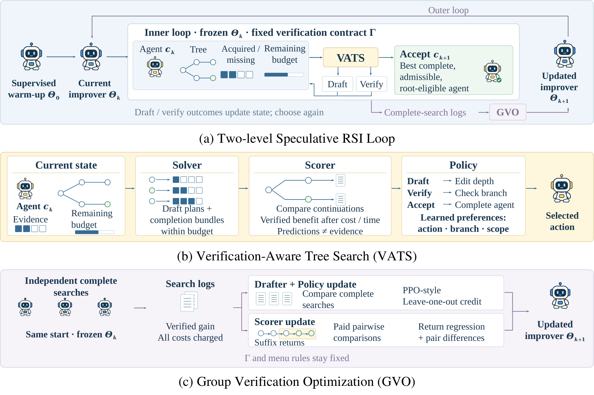
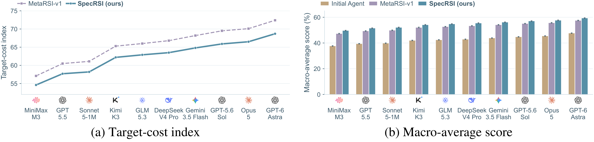

<p align="center">
  
</p>

<h1 align="center">Drafting Agents, Not Just Tokens:<br>Speculative Recursive Self-Improvement for Agentic Systems</h1>

<p align="center"><strong>SpecRSI</strong></p>

<p align="center">
  
  
  
  <a href="https://github.com/xuxinthuad/SpecRSI"></a>
  <a href="LICENSE"></a>
</p>

**English** | [简体中文](README.zh-CN.md)

---

## 🔥 What's New

- **October 10, 2026** — We released **SpecRSI v1**, including the code, experimental guide, and reproducibility specifications.

## 📌 Citation

If you use SpecRSI in your work, please cite:

```bibtex
@misc{xu2026specrsi,
  title        = {Drafting Agents, Not Just Tokens: Speculative Recursive Self-Improvement for Agentic Systems},
  author       = {Xin Xu and Ke Cheng and Hao Wang and Yangru Huang and
                  Yanghao Xiao and Zhichao Chen and Zhisheng Zhong and
                  Xun Liu and Yi Li and Qian Li and Haibin Lv and
                  Jun Zhang and Jie Jiang and Zhouchen Lin},
  year         = {2026},
  url          = {https://github.com/xuxinthuad/SpecRSI}
}
```

---

## 🔎 Overview

SpecRSI improves agents by drafting executable successors before every intermediate version has been fully evaluated, while requiring complete verification before adoption. Verification-Aware Tree Search (VATS) allocates a limited budget between further edits and outstanding checks. Group Verification Optimization (GVO) learns the improver from completed searches while keeping the real evaluation contract fixed.

The manuscript reports five main findings:

- **Draft ahead, verify before adoption.** Incomplete or repairable parents can support further edits; only the selected complete, admissible successor can be adopted.
- **Consistent scientific progress.** SpecRSI exceeds Janus in all five primary scientific domains and all 50 additional scientific backbone–task pairs.
- **Consistent cross-backbone improvements.** Across all twenty system backbones, SpecRSI achieves higher four-task macro-average scores than MetaRSI-v1; the ten representative backbones in Figure 2 also show lower target-cost indices. Gains persist when task-model weight updates are disabled.
- **Stronger coding successors.** In the separate SWE-Pro coding-validation profile, success reaches **69.4% versus HGM's 64.3%**, at a **20.8% lower target-cost index**.
- **Completion-aware resource allocation.** At fixed full-state information, permitting verification bundles improves gain and reduces total cost; the separate lifecycle ledger reports a **5.7% lower total-cost index** than MetaRSI-v1.

## 🧩 Method



[Vector PDF](docs/figures/method-overview.pdf) · [Vector SVG](docs/figures/method-overview.svg)

The method has two timescales:

1. **Inner search:** immutable candidate versions, admitted outcomes, missing checks, and remaining resources form the state. The improver is frozen throughout each search. DRAFT executes bounded edits; VERIFY obtains contracted outcomes; ACCEPT returns the highest-scoring complete, admissible version.
2. **Outer learning:** independent complete searches from the same starting conditions provide verified gain minus all incurred costs. GVO updates the Drafter and work-selection Policy from sampled choices, and the Scorer from observed suffix returns and paid same-state contrasts. Updated parameters are frozen for the next collection round.

Within VATS, the **Solver** constructs feasible completion bundles, including dependencies, shared setups, conflicts, expense caps, and attempt limits. The **Scorer** estimates eventual verified improvement net of subsequent cost and time, rather than treating current candidate quality as continuation value. The **Policy** selects the next action, branch, and scope, then replans after execution updates the state.

Predictions never replace observed evidence. A valid outcome may report failure; missing evidence and failed requirements have different meanings. Only the adopted version needs complete admissible evidence. All preparation, unsuccessful edits, failed checks, copies, and unfinished work remain charged. Paid forced continuations supply Scorer labels only and are excluded from actor updates.

## 🧪 Benchmarks and experimental protocol

The paper evaluates several distinct profiles. Their initial agents, edit permissions, scores, and cost definitions should be compared within each profile.

| Profile | Domains or datasets | Reported evaluation |
|---|---|---|
| Scientific discovery | PyBaMM, AQM, FDTD, Reactor, IRP | Terminal gain and call-axis AUBC, retaining native objective units |
| Matched system improvement | Terminal-Bench 2.1 (TB2.1), SWE-Pro, GPQA-hard100, AIME | Task scores (%), separately within D/H/M and D+H permissions |
| Coding validation | SWE-Pro, HumanEval-Ext., MBPP-Advanced, FixBench | Success (%), target-cost index, and a distinct execution-completion profile |
| Prompt optimization | GPQA-hard100, MMLU-Pro, GSM8K-Opt. | Score (%), absolute gain (percentage points), and profile-specific cost |
| Workflow optimization | PlanBench, Math, MBPP, Game24 | Success (%) and task-inference token counts, excluding search and training |
| Mechanism studies | Information/scope, planning, evidence, learning, resource controls | Verified gains, completion, prediction diagnostics, and separately defined cost indices |

**Qwen3.5-35B-A3B** is the reference backbone for mechanism studies and the primary matched system comparison. Validation uses **five training seeds with three nested searches per seed**. Scientific backbone evaluation covers ten backbones and five domains, totaling 50 pairs. Figure 2 and Figure S2(a) use the same ten backbone models for system and scientific evaluation, respectively. Figure S2(b) covers the full twenty-backbone system comparison, including the self-hosted reference model and nineteen provider-API backbones.

The ten backbones shared by Figure 2 and Figure S2(a) are GPT-6-Astra, Claude-Opus-5, Gemini-3.5-Flash, DeepSeek-V4-Pro, GLM-5.3, Kimi-K3, MiniMax-M3, GPT-5.6-Sol, Claude-Sonnet-5-1M, and GPT-5.5.

### Implementation configuration

| Component | Paper specification |
|---|---|
| Verification | Fixed contract; complete admissible evidence authorizes adoption; main SpecRSI comparisons use direct checks |
| D/H/M permissions | Data, harness, and task-model edits allowed |
| D+H permissions | Data and harness edits; no task-model weight updates |
| Open-model representation | Frozen text representations |
| Drafter | Rank-16 trainable adapter |
| Scorer and Policy | Separate trainable branches using message passing and set attention |
| Branch dimensions | Width 256; four attention heads |
| State inputs | Parent–child context, typed candidate–job relations, plan features, budget, attempt allowance, complete score, missing masks, observed outcomes |
| Completion-seed solver | SciPy MILP interface with HiGHS; independent feasibility checks on returned bundles |
| Initial target catalog | Up to four candidate targets, four pairwise target unions, four singleton closures |
| Refinement limits | Four extensions per seed; 96 uncached whole-plan value queries per decision |
| Offered menu | 32 retained plans by default, including DRAFT and ACCEPT alternatives |
| Collection / deployment | Sample during collection; maximize policy preference during deployment |
| Learning | Supervised warm-up, then GVO; one observed-return Scorer, separate Policy preferences |
| Repeated rounds | Round 1 initializes; rounds 2–5 evaluated; task agents carried; real evaluator fixed |

### Reproducibility specifications

The [complete reference configuration](docs/REPRODUCIBILITY.md) fixes data, model, simulator, and execution identities while retaining SpecRSI's adaptive allocation of edits and checks under a shared verification contract. **Qwen3.5-35B-A3B is self-hosted in native BF16; the other evaluated backbones use provider APIs.** The local optimization settings below apply to the reference improver, without local gradient updates to provider weights.

- **Data and splits:** [14 versioned data pools](docs/reproducibility-datasets.json), [42 complete ordered split lists](docs/reproducibility-splits.json), and **139,865 member IDs**, with upstream revisions and SHA-256 fingerprints. Content/group hashing uses seed `20260916` and 20%/40%/40% intervals, with the specified MATH, PlanBench, and AIME-extension rules. [Subset manifests](docs/reproducibility-subsets.json) fix campaign sampling and exclusions; [SWE instance records](docs/reproducibility-swe-images.json) pin 730 base commits and container digests.
- **Scientific scenarios:** [56 cases and 168 role-specific configurations](docs/reproducibility-science.json): PyBaMM 12, AQM 11, FDTD 12, Reactor 10, and IRP 11. Simulator parameters, seeds, tolerances, feasibility constraints, and [evaluation protocols](docs/reproducibility-evaluation.json) keep comparison conditions explicit.

| Item | Reference configuration |
|---|---|
| Model | `Qwen/Qwen3.5-35B-A3B`, revision `59d61f3ce65a6d9863b86d2e96597125219dc754`; unquantized BF16 base; matching tokenizer/chat template; frozen text backbone, router, and experts |
| Learned roles | Drafter LoRA rank/alpha/dropout **16/32/0**, including attention and Gated DeltaNet projections; separate Scorer/Policy heads, width **256**, **4** heads; trainable adapters/heads in FP32 |
| SFT | AdamW, **1 epoch**, component minibatch **1**, learning rate **`2e-5`**, weight decay **`1e-4`**, joint gradient-norm cap **1** |
| GVO | **2** frozen collection/update rounds, **3** independent complete searches/group; at most **1 joint SGD update per complete collection**; actor/Scorer learning rates **`1e-3` / `5e-4`**, zero momentum/weight decay; PPO clip **0.2**, KL weight **0.02** to the fixed SFT actor |
| Seeds | **`2026101001`–`2026101005`** per domain, nested search labels **0–2**; matched methods share SHA-256-derived search seeds |
| Inputs | Training sequence cap **2,048** tokens; frozen semantic encoding allocation **8,192** tokens across nodes; inference context **32,768** tokens |
| Hardware | Eight-H20 host; **1 H20 per scientific domain plus a separate H20 for serving**, each 97,871 MiB; two AMD EPYC 9K84 96-core CPUs; no cross-device gradient synchronization |
| Training stack | Python **3.11.6**, PyTorch **2.6.0+cu124**, Transformers **5.17.0**, PEFT **0.19.1**, Accelerate **1.14.0**, FLA Core **0.3.2** |
| Serving stack | PyTorch **2.10.0**, vLLM **0.19.1**, Transformers **4.57.6**; BF16, text-only/eager, one concurrent sequence, 2,048 batched tokens |

[Model/file identities](docs/reproducibility-models.json), [training parameters](docs/reproducibility-training.json), [complete configuration registry](docs/reproducibility-training-configs.json), [checkpoint fingerprints](docs/reproducibility-checkpoints.json), and [hardware/software versions](docs/reproducibility-environment.json) provide the remaining settings. Training and serving use their respective pinned environments. Scientific dependencies include PyBaMM **25.12.2**, ns-3 **3.44.post0**, NumPy **1.26.4**, SciPy **1.17.1**, Pyomo **6.9.5**, and HiGHS **1.12.0**.

## 📊 Main reported results

### Scientific discovery: Table 1A

Entries show mean ± reported SD. Higher terminal gain and AUBC are preferred within each domain.

| Terminal gain | PyBaMM | AQM | FDTD | Reactor | IRP |
|---|---:|---:|---:|---:|---:|
| Alg.-Only | 0.12 ± 0.01 | 0.09 ± 0.01 | 0.14 ± 0.01 | 0.11 ± 0.01 | 0.10 ± 0.01 |
| Direct-LLM | 0.21 ± 0.01 | 0.17 ± 0.01 | 0.24 ± 0.02 | 0.19 ± 0.01 | 0.18 ± 0.01 |
| Embed-GP | 0.30 ± 0.02 | 0.25 ± 0.01 | 0.33 ± 0.02 | 0.27 ± 0.01 | 0.25 ± 0.01 |
| Janus | 0.36 ± 0.02 | 0.30 ± 0.02 | 0.39 ± 0.02 | 0.32 ± 0.02 | 0.30 ± 0.01 |
| **SpecRSI** | **0.48 ± 0.02** | **0.41 ± 0.02** | **0.52 ± 0.02** | **0.44 ± 0.02** | **0.42 ± 0.02** |

| Call-axis AUBC | PyBaMM | AQM | FDTD | Reactor | IRP |
|---|---:|---:|---:|---:|---:|
| Alg.-Only | 7.3 ± 0.4 | 5.1 ± 0.3 | 8.5 ± 0.5 | 6.7 ± 0.3 | 5.8 ± 0.2 |
| Direct-LLM | 19.2 ± 0.6 | 14.3 ± 0.5 | 22.6 ± 0.7 | 16.2 ± 0.4 | 13.7 ± 0.4 |
| Embed-GP | 30.5 ± 0.8 | 24.8 ± 0.7 | 36.2 ± 0.9 | 27.4 ± 0.6 | 23.1 ± 0.5 |
| Janus | 42.8 ± 1.0 | 34.7 ± 0.8 | 51.3 ± 1.1 | 36.9 ± 0.8 | 31.5 ± 0.7 |
| **SpecRSI** | **56.7 ± 1.2** | **45.8 ± 1.0** | **66.9 ± 1.3** | **49.3 ± 1.0** | **42.1 ± 0.9** |

Relative to Janus, SpecRSI improves terminal gain by **33.3%–40.0%** and AUBC by **30.4%–33.7%**, with only a **7.2%** increase in the scientific total-cost index (**158.7 versus 148.1**). The separate 50-pair backbone sweep reports positive uplifts throughout: **17.8%–27.6%** for terminal gain and **15.7%–19.8%** for AUBC.

### Matched system permissions: Table 1B

Scores (%) show mean ± SD. D/H/M permits data, harness, and model edits.

| D/H/M method | TB2.1 | SWE-Pro | GPQA-hard100 | AIME |
|---|---:|---:|---:|---:|
| Initial | 23.6 ± 0.7 | 10.3 ± 0.5 | 71.2 ± 0.8 | 55.0 ± 0.6 |
| Data-RSI | 27.4 ± 0.8 | 12.4 ± 0.6 | 73.8 ± 0.9 | 57.7 ± 0.7 |
| Harness-RSI | 29.4 ± 0.9 | 14.9 ± 0.7 | 78.8 ± 1.0 | 63.3 ± 0.8 |
| Model-RSI | 27.0 ± 0.8 | 14.0 ± 0.6 | 75.4 ± 0.9 | 59.3 ± 0.7 |
| Fixed D→M→H | 30.3 ± 0.9 | 15.3 ± 0.7 | 79.4 ± 1.0 | 64.3 ± 0.8 |
| Static router | 30.8 ± 1.0 | 14.9 ± 0.7 | 79.6 ± 1.1 | 64.0 ± 0.9 |
| MetaRSI-v1 | 31.9 ± 1.0 | 19.5 ± 0.8 | 83.8 ± 1.1 | 68.3 ± 0.9 |
| **SpecRSI** | **33.5 ± 1.1** | **21.7 ± 0.9** | **86.1 ± 1.2** | **71.2 ± 1.0** |

| D+H method: no model updates | TB2.1 | SWE-Pro | GPQA-hard100 | AIME |
|---|---:|---:|---:|---:|
| MetaRSI-H | 28.7 ± 0.8 | 14.2 ± 0.6 | 77.5 ± 0.9 | 61.8 ± 0.7 |
| **SpecRSI-H** | **30.1 ± 0.9** | **16.3 ± 0.7** | **79.9 ± 1.0** | **64.7 ± 0.8** |

Mean advantages over the matched MetaRSI controls are **2.25 pp with D/H/M** and **2.20 pp with D+H**. Improvements therefore persist without task-model weight updates.



[Vector PDF](docs/figures/backbone-comparison.pdf) · [Vector SVG](docs/figures/backbone-comparison.svg)

Across the full twenty-backbone system comparison in Appendix B, SpecRSI improves four-task macro-average scores over MetaRSI-v1 by **1.85–2.38 pp**. Figure 2 presents ten representative backbones, all with higher macro-average scores and lower target-cost indices; their total-cost indices are **0.83%–0.90% higher** than MetaRSI-v1.

### Separate coding, prompt, and workflow profiles

| Profile | Comparator | Comparator → SpecRSI score (%) | Associated resource comparison |
|---|---|---|---|
| SWE-Pro coding validation | HGM | 64.3 ± 1.1 → **69.4 ± 1.2** | Target-cost index 76.8 → **60.8** |
| HumanEval-Ext. coding | HGM | 66.8 → **72.6** | Target-cost index 74.3 → **59.3** |
| MBPP-Advanced coding | HGM | 57.5 → **64.9** | Target-cost index 79.6 → **62.1** |
| FixBench coding | HGM | 53.7 → **61.5** | Target-cost index 82.1 → **64.7** |
| GPQA-hard100 prompt | GEPA+Merge | 78.5 → **82.4** | Profile cost 55.7 → **53.1** |
| MMLU-Pro prompt | GEPA+Merge | 70.8 → **75.3** | Profile cost 42.1 → **41.8** |
| GSM8K-Opt. prompt | GEPA+Merge | 66.1 → **71.2** | Profile cost 38.7 → 39.4 |
| PlanBench workflow | EMAS | 62.7 → **67.8** | Task-inference tokens 10,210 → **9,290** |
| Math workflow | EMAS | 57.1 → **62.3** | Task-inference tokens 11,130 → **10,390** |
| MBPP workflow | EMAS | 54.6 → **59.4** | Task-inference tokens 11,720 → **11,020** |
| Game24 workflow | EMAS | 51.2 → **54.7** | Task-inference tokens 12,830 → **12,080** |

Coding baselines also include DGM, SICA, Beam-Spec, and distinct FlashEvolve asynchronous/optional modes. Prompt controls include MIPROv2, MIPROv2 without demonstrations, Trace, TextGrad, and GEPA. Workflow controls include Genesis, Genesis+SOP, AFlow, and ADAS.

The SWE-Pro coding result uses a different profile from the matched system table's 21.7% result. Execution completion is another endpoint: SpecRSI reports 94.7%, versus 91.2% and 92.8% for the two FlashEvolve modes. The separate frozen-successor audit reports **69.4 ± 1.3%** and **23/25 target hits** on its declared untouched split.

## 🔬 What the ablations establish

- **Verification scope:** with full-state information fixed, singleton → bundle gain is **4.8 → 6.3 pp**, total cost **63.1 → 59.2**, completion failure **9.8% → 6.5%**, and hit rate **84% → 92%**. This isolates work scope beyond simply providing richer inputs.
- **Planning:** full SpecRSI has the highest reported mean gain and lowest total-cost index among seven conditions at all eight budget caps from 10% to 150%. At 70%, full versus additive planning gives **5.99 versus 4.73 pp**, with **201 versus 141 ms** planning but **58.9 versus 65.1** total cost.
- **Learning beyond retained artifacts:** updates improve reset gains **4.1 → 5.2 pp**, carry gains **4.8 → 6.2 pp**, and same-released-artifact gains **5.7 → 6.9 pp**. The latter cost index falls **54.2 → 50.8**.
- **Scorer supervision:** adding pair loss on the same acquired arms increases gain **5.4 → 6.3 pp** and reduces RMSE **1.05 → 0.85**, while training cost rises **23.7 → 28.4**.
- **Repeated rounds:** updated SpecRSI accumulates **21.7 pp** by round 5, versus **17.8 pp** for updated MetaRSI and **13.8 pp** for the original-improver SpecRSI control. Every evaluated round retains a positive incremental gain.
- **Bounded planning:** 32 offered plans achieve the highest tested net return, **4.7**, versus **4.5** with 64. Seeded growth yields Final **5.9 versus 5.8** for exhaustive construction at **56.2% lower planning cost**.
- **Parallelism and cost:** eight workers deliver a **6.7× speedup (1,287 → 192 seconds)** with **9.0% more cumulative worker time**; in the separate lifecycle comparison, SpecRSI achieves a **5.7% lower total-cost index than MetaRSI-v1 (106.3 versus 112.7)**.

**Adaptive verification reduces cost.** Batching lowers mean verification cost by **17.1%**, **6.5%**, and **12.2%** in the *Dependent fail*, *Independent fail*, and *Early cancellation* configurations, respectively. VATS selects feasible singleton checks or completion bundles according to their expected verified return net of cost and replans after each executed block. This lets verification scope adapt to the search state and execution conditions.

## 🗂️ Source layout

| Path | Contents |
|---|---|
| `src/specrsi/core` | Immutable versions, evidence admission, budgets, ledgers, execution, acceptance, VATS |
| `src/specrsi/planning` | Completion constraints and bounded work-plan construction |
| `src/specrsi/learning` | Role models, warm-up, grouped trajectories, observed-return and pair objectives |
| `src/specrsi/models` | Model clients, checkpoint interfaces, optional local server |
| `src/specrsi/benchmarks` | Data interfaces and native/external evaluator adapters |
| `src/specrsi/science` | PyBaMM, AQM, FDTD, Reactor, IRP implementations and registry |
| `src/specrsi/baselines` | Baseline adapters and task-specific controls |
| `scripts` / `tests` | Caller-configured entry points / implementation tests |

## ⚙️ Installation and testing

Use **Python 3.11 or newer**.

```sh
git clone https://github.com/xuxinthuad/SpecRSI.git
cd SpecRSI
python -m venv .venv
source .venv/bin/activate
python -m pip install -e '.[test]'
python -m specrsi.cli doctor
```

Base dependencies are NumPy, SciPy, PyYAML, and HTTPX. Optional extras are `test`, `models`, `data`, and `solver`. Learned-role execution and the full test suite require model dependencies:

```sh
python -m pip install -e '.[models,test]'
python -m pytest -q
```

The model extra specifies PyTorch >=2.6, Transformers 4.57.6, Hugging Face Hub 0.36.2, PEFT 0.18.1, Accelerate >=1.2, FastAPI >=0.115, and Uvicorn >=0.30. The data extra includes Datasets 3.6.0; the solver extra pins Pyomo 6.9.5 and highspy 1.12.0. Install the extras needed by your integration with `python -m pip install -e '.[models,data,solver,test]'`.

The built-in completion solver uses SciPy MILP; it does not require the optional Pyomo/HiGHS extra. `doctor` reports installed versions and contacts a model endpoint only when explicitly configured. **Optional installation check:** `python -m specrsi.cli demo` runs a small CPU-only example to check candidate creation, evidence bookkeeping, budget accounting, and acceptance, without downloading datasets or calling model APIs. For VATS experiments, use the complete configurations below.

**Release verification:** editable installation, doctor, demo, and the following no-model suite were checked under Python 3.13; **267 tests passed**.

```sh
python -m pytest -q \
  tests/test_public_interfaces.py tests/test_core_contracts.py \
  tests/test_core_search.py tests/test_core_vats.py \
  tests/test_completion.py tests/test_native_completion.py \
  tests/test_planning_batches.py tests/test_sampling_execution.py \
  tests/test_vats_parallel.py tests/test_statistics.py \
  tests/test_output_contracts.py tests/test_jsonl_loading.py \
  tests/test_model_client_sampling.py tests/test_model_reasoning_content.py \
  tests/test_answer_strategies.py tests/test_workflows.py
```

## 🚀 Running experiments and training

Run VATS on text/code/workflow tasks with `run_experiment.py`, or on native scientific tasks with `run_paper_science.py`. The examples below use complete YAML configurations included in this repository. Follow the [reproducibility guide](docs/REPRODUCIBILITY.md) to prepare the pinned model, task data or simulators, and training/serving environments; set the device and endpoint for your deployment.

```sh
# HotpotQA: train the roles, then evaluate with VATS
python scripts/train.py --config configs/training/paper_pdf_hotpotqa.yaml --stage two_stage
python scripts/run_experiment.py --config configs/experiments/paper_pdf_hotpotqa.yaml

# Reactor: train the roles, then evaluate with VATS
python scripts/train.py --config configs/training/paper_pdf_reactor.yaml --stage two_stage
python scripts/run_paper_science.py --config configs/experiments/paper_pdf_reactor.yaml
```

`--stage two_stage` runs supervised warmup followed by GVO and saves the role checkpoint at the path used by the matching experiment configuration. If that checkpoint is already available, run the evaluation command directly. Each experiment configuration specifies its inputs, seed, budget, output directory, and `search.controller: learned` to load the trained Drafter, Scorer, and Policy. Scientific runs use the registered contracts, case manifests, and separate selection/audit scenarios. Further settings are listed in the [training configuration catalog](docs/reproducibility-training-configs.json).

The science comparison runner, `run_paper_science_comparison.py`, evaluates `initial`, `best_of_n`, `random_search`, and `specrsi` on common frozen held-out scenarios, with the selected agents fixed before audit evaluation.

**VATS configuration by stage:** experiment YAML files use `search.algorithm: vats_pdf` for search and evaluation; training YAML files use `collection.algorithm: vats_pdf` to collect verified search trajectories for warmup and GVO. Both select `VATSEngine`; optimizer, learning rate, and batch settings are configured separately under `training`.

The learned path validates HF checkpoint architecture, feature dimensions, role heads, adapters, and applicable frozen-text identity before paid task calls. Training consumes verified JSONL or a configured collector. The optional local model server requires an explicit model lock, integrity manifest, port, and request-log destination.

### Data and native evaluator interfaces

Text/code/workflow integrations use this relative layout:

```text
data/manifests/<dataset>.json
data/processed/<dataset>/selection.jsonl
data/processed/<dataset>/audit.jsonl
```

Manifest file records include `path`, `bytes`, and `sha256`; paths resolve against the parent of `data_root`. Examples contain `id`, `dataset`, `split`, `prompt`, `reference`, and optional `metadata`. Split overlap checks use identifiers, content hashes, and optional group identity. Native harness integration exchanges request/result JSON and validates artifact hashes, evaluator identity, required fields, score units, and score range.

Scientific registry integrations supply:

```text
configs/science/<domain>.json
configs/science/development/<domain>.json
configs/science/audit/<domain>.json
configs/science/cases/<domain>.json
```

The case manifest declares `case_count`, `cases`, and registered patches. PyBaMM requires its simulator; AQM requires native ns-3.44 libraries and a C++20 compiler; FDTD requires Numba; Reactor uses SciPy stiff ODE integration; IRP uses NumPy inventory simulation. The PyBaMM adapter explicitly distinguishes its registered predictor from the undisclosed original predictor. Isolated native executors may additionally require Linux bubblewrap or a digest-pinned Docker runtime.

AQM caches compiled native executables in `/opt/specrsi-science/bin`; this directory must be writable.

The generic dataset runner accepts the following dataset identifiers. Supply the corresponding dataset files and matching evaluator for each task.

- **Math and reasoning:** `game24`, `aime25`, `aime_2025_2026`, `math`, `livebench_math`.
- **Question answering and fact verification:** `hotpotqa`, `hover`.
- **Instruction following:** `ifbench`.
- **Code:** `mbpp`, `polyglot`, `swe_verified`, `swe_lite`.
- **Privacy:** `pupa`.
- **Planning:** `planbench`.

---

## ⚖️ License

The SpecRSI code is released under the [MIT License](LICENSE). Third-party libraries, datasets, and models remain subject to their respective licenses.
