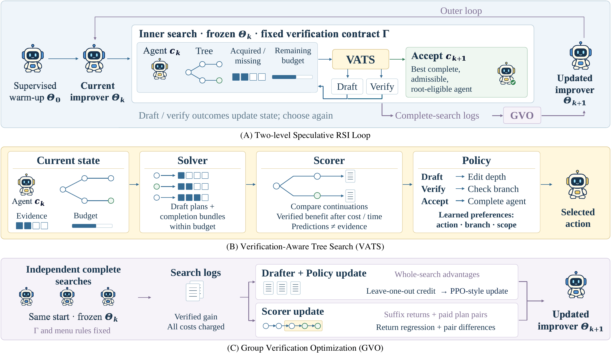

<p align="center">
  
</p>

<h1 align="center">Drafting Agents, Not Just Tokens:<br>Speculative Recursive Self-Improvement for Agentic Systems</h1>

<p align="center"><strong>SpecRSI</strong></p>

<p align="center">
  <a href="https://arxiv.org/pdf/2610.16491"></a>
  
  
  <a href="https://github.com/xuxinthuad/SpecRSI"></a>
  <a href="LICENSE"></a>
</p>

---

## 🔥 What's New

- **October 28, 2026** — Updated the result tables, figures, online supplement, and model-source list.
- **October 10, 2026** — We released **SpecRSI v1**, including the code, experimental guide, and reproducibility specifications.

## 📌 Citation

If you use SpecRSI in your work, please cite:

```bibtex
@misc{xu2026specrsi,
  title        = {Drafting Agents, Not Just Tokens: Speculative Recursive Self-Improvement for Agentic Systems},
  author       = {Xin Xu and Ke Cheng and Hao Wang and Yangru Huang and
                  Yanghao Xiao and Zhichao Chen and Zhisheng Zhong and
                  Xun Liu and Yi Li and Qian Li and Haibin Lv and
                  Jun Zhang and Jie Jiang and Zhouchen Lin},
  year         = {2026},
  url          = {https://github.com/xuxinthuad/SpecRSI}
}
```

---

[Paper results](docs/results/README.md) · [Online supplement](docs/results/online_supplement.md) · [Configuration guide](docs/REPRODUCIBILITY.md)

## Benchmarks in the paper

Section 4.1 and Appendix B define the following evaluation groups. Repeated task names refer to the experiment-specific cohort, starting agent, permissions, and budget.

| Evaluation group | Tasks |
| --- | --- |
| Scientific optimization | PyBaMM, AQM, FDTD, Reactor, IRP |
| Agent-system performance | Terminal-Bench 2.1, SWE-Pro v1.0, GPQA-hard100, AIME 2025 I/II (30 problems) |
| Code optimization | SWE-Pro, HumanEval-Ext., MBPP-Advanced, FixBench |
| Prompt optimization | GPQA-hard100, MMLU-Pro, GSM8K-Opt. |
| Workflow optimization | PlanBench, Math, MBPP, Game24 |

HumanEval-Ext., MBPP-Advanced, GPQA-hard100, and GSM8K-Opt. are benchmark-derived profiles; FixBench uses Fixbench-RTL, and workflow Math follows EMAS. The [results page](docs/results/README.md) gives the tables, figures, and protocols. The executable configuration registry also includes additional tasks, such as HotpotQA, HoVer, IFBench, LiveBench Math, Polyglot, PUPA, and SWE-bench Lite/Verified; these are separate profiles, not replacements for the manuscript benchmarks.

## Quick start

Download and extract this repository, then open a terminal in its root directory. Use Python 3.11 or newer.

```sh
# Install the CPU dependencies and tests.
python -m venv .venv
source .venv/bin/activate
python -m pip install -e '.[test]'

# Check the environment, then run a small end-to-end search.
python -m specrsi.cli doctor
python -m specrsi.cli demo
```

The demo runs on CPU without model downloads or API calls. It exercises candidate creation, evidence bookkeeping, budget accounting, and acceptance.

## Run the Reactor simulator

```sh
# Evaluate all 12 CSTR instances with their default coolant flows.
python -m specrsi.science.reactor_cstr --all-cases --output reports/reactor_reference.json

# Evaluate case 11 with a chosen coolant flow (case IDs are zero-based).
python -m specrsi.science.reactor_cstr --case-id 10 --coolant-flow 28
```

The JSON output contains each trajectory's score, admissibility, and temperature/pressure extrema. [Model equations and instance parameters](docs/results/reactor_model.md) define the `reference` CSTR profile.

These commands evaluate the standalone 12-instance CSTR profile, not the paper's optimization comparison. The older registered scientific profiles use eleven AQM cases, ten Reactor cases, and eleven IRP cases; the current FDTD default candidate fails its crosstalk check. Those profiles do not reproduce the paper's five 12-instance scientific evaluations.

## Additional executable example: HotpotQA

The HotpotQA example requires Linux, two visible CUDA GPUs with sufficient memory, model weights, prepared task data, and a healthy model endpoint. The default setup serves the frozen model on GPU 0 and runs the learned roles on `cuda:1`, using `http://127.0.0.1:18085`. The [configuration guide](docs/REPRODUCIBILITY.md) gives model download and serving commands. This example demonstrates the training and evaluation workflow on HotpotQA, which is not a benchmark in the paper. Its YAML files define its own dataset split, collection size, and budget; running it does not reproduce the full manuscript evaluation.

```sh
python -m pip install -e '.[models,data,test]'
python scripts/prepare_data.py --datasets hotpotqa

# Run supervised warm-up followed by GVO; save the role checkpoint.
python scripts/train.py --config configs/training/paper_pdf_hotpotqa.yaml --stage two_stage

# Load that checkpoint and evaluate with VATS.
python scripts/run_experiment.py --config configs/experiments/paper_pdf_hotpotqa.yaml
```

Training writes to `artifacts/training/qwen35/paper_pdf_hotpotqa/`; evaluation writes to `results/qwen35/experiments/paper_pdf_hotpotqa/`. With an existing checkpoint, run the evaluation command directly. Each YAML specifies its dataset, seed, budget, collection size, and outputs. The [configuration catalog](docs/reproducibility-training-configs.json) lists the other executable profiles; [Tables S1 and S3](docs/results/README.md) specify the manuscript experiments.

## AIME data profiles

The paper's AIME column uses the 30 problems from AIME 2025 I/II. The repository has two executable AIME profiles with different partitions:

| Profile | Development | Selection | Audit | Preparation / example configuration |
| --- | --- | --- | --- | --- |
| `aime25` | 13 AIME 2025 problems | 11 AIME 2025 problems | 6 AIME 2025 problems | [Preparation](scripts/prepare_data.py) (`--datasets aime25`); [configuration](configs/experiments/prospective/aime25.yaml) |
| `aime_2025_2026` | 15 AIME 2024 problems | 15 AIME 2024 problems | 30 AIME 2025 + 30 AIME 2026 problems | [Preparation](scripts/prepare_performance_aime.py); [configuration](configs/performance/aime_qwen35_fp8_full.json) |

The configurations select distinct `dataset` and `data_root` values; these names are not interchangeable. [Partition metadata](data/reproduction/dataset_profiles.json) and [overlap records](data/reproduction/cross_dataset_overlap.json) show that all 30 AIME 2025 problems occur in both profiles: 13 development, 11 selection, and 6 audit items in `aime25` are audit items in the extension. The extension therefore defines a separate campaign, not an independent unseen set relative to `aime25`. Neither profile's audit partition is the paper's 30-problem evaluation set, and these configuration names do not establish which run produced the paper's AIME results.

## Method



1. **Verification-Aware Tree Search (VATS).** With the improver frozen, the Solver constructs feasible completion plans, the Scorer predicts continuation gain, and the Policy selects an action, branch, and scope. DRAFT edits agents; VERIFY obtains real outcomes; ACCEPT returns the best complete, admissible version.
2. **Group Verification Optimization (GVO).** Complete searches from common starting conditions provide whole-search advantages for Drafter/Policy updates and suffix returns and paid plan comparisons for Scorer updates. The reference profile uses λ = μ = 0 and optimizes verified gain under hard resource caps.

## Results

The experiments show:

- Across five scientific tasks, mean terminal gain and call-axis AUBC exceed Janus by **60.0%–96.3%** and **32.1%–91.6%**, respectively.
- Under matched D/H/M permissions, system scores exceed MetaRSI-v1 by **3.5–4.4 pp**. Restricting updates to D+H retains a **3.48 pp** average advantage.
- Frozen-improver transfer improves all **50 scientific backbone–task pairs** and yields **1.30–2.70 pp** higher scores across twenty system backbones.
- Across eleven code, prompt, and workflow benchmarks, score improvements are **3.5–6.0 pp** over the best-scoring baseline on each task, with **3.2%–17.6%** lower inference cost.
- Instance-level comparisons give **142.6%** higher PyBaMM gain and **6.0 pp** higher SWE-Pro resolution rate, at **7.0%** and **9.2%** lower token cost.
- Eight workers reduce elapsed time from **1,287 to 192 s** (**6.7×**) with **19.0%** more active worker time; twenty reduce it to **100 s** (**12.9×**) with **55.2%** more active worker time.

All numbered figures and tables, evaluation protocols, and seed data are collected on the [results page](docs/results/README.md). The [online supplement](docs/results/online_supplement.md) contains the additional D+H `csvcut` case and Drafter prompt template. [Model sources](docs/results/model_sources.md) cover the cross-backbone comparisons.

SD is calculated across five seed means with the n−1 denominator. Search cost counts forward input/output tokens, including tool-return text. Training cost counts forward-pass and forced-continuation tokens; backward computation is measured in GPU time. Lifecycle totals and per-seed totals are identified in the relevant tables.

## Repository layout

| Path | Contents |
| --- | --- |
| `src/specrsi/core` | Search state, verification contracts, VATS, and completion planning |
| `src/specrsi/learning` | Drafter, Scorer, Policy, and GVO training |
| `src/specrsi/science` | Scientific evaluators and instance registry |
| `src/specrsi/benchmarks` | Dataset loading and task evaluators |
| `configs` | Model, training, experiment, and simulator settings |
| `scripts` | Data preparation, training, and evaluation commands |
| `tests` | Implementation tests |
| `docs/results` | Manuscript results and online supplement |

## Tests

```sh
# CPU checks for the search and completion solver.
python -m pytest -q tests/test_core_contracts.py tests/test_core_vats.py tests/test_completion.py

# Full suite after installing the model dependencies.
python -m pytest -q
```

## License

SpecRSI is released under the [MIT License](LICENSE). Third-party libraries, datasets, and models retain their respective licenses.
