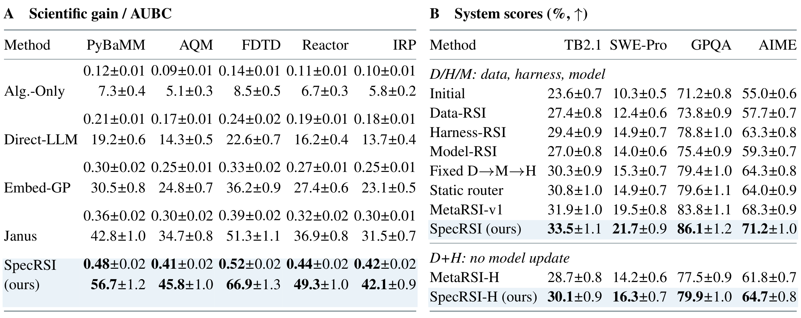

# SpecRSI：面向智能体系统的推测式递归自改进

[English](README.md) | **简体中文**

**论文《Drafting Agents, Not Just Tokens: Speculative Recursive Self-Improvement for Agentic Systems》的代码与实验指南。**

SpecRSI 在中间版本尚未完成全部评估时，就为智能体起草可执行的后继版本；正式采用后继版本之前，仍要求完成验证。Verification-Aware Tree Search（VATS，验证感知树搜索）在有限预算内分配进一步编辑与尚未完成的检查。Group Verification Optimization（GVO，组验证优化）利用完整搜索学习改进器，同时保持真实评估契约不变。

论文报告了五项主要发现：

- **提前起草，验证后采用。** 尚未完成评估或仍可修复的父版本可以继续编辑；只有最终选中的完整、可接纳后继版本才能被采用。
- **持续的科学任务进展。** 在五个主要科学领域和另外 50 个科学任务的骨干模型–任务组合中，SpecRSI 均优于 Janus。
- **跨骨干模型的一致提升。** 在图 2 的十个骨干模型上，SpecRSI 的四任务宏平均分数均高于 MetaRSI-v1，目标成本指数均更低；禁止更新任务模型权重时，提升依然存在。
- **更强的代码后继版本。** 在单独的 SWE-Pro 代码验证实验中，成功率达到 **69.4%，高于 HGM 的 64.3%**，同时**目标成本指数降低 20.8%**。
- **考虑验证完成的资源分配。** 在完整状态信息固定时，允许组合验证检查可提高收益并降低总成本；单独的生命周期账本报告，相比 MetaRSI-v1，**总成本指数降低 5.7%**。

## 方法


[矢量 PDF](docs/figures/method-overview.pdf) · [矢量 SVG](docs/figures/method-overview.svg)

方法包含两个时间尺度：

1. **内层搜索：** 状态由不可变候选版本、已接纳结果、缺失检查和剩余资源组成。每次搜索期间，改进器保持冻结。DRAFT 执行有界编辑；VERIFY 获取验证契约要求的结果；ACCEPT 返回分数最高的完整、可接纳版本。
2. **外层学习：** 从相同起始条件出发的独立完整搜索，提供扣除全部已发生成本后的验证收益。GVO 根据采样决策更新 Drafter 和工作选择 Policy，并根据已观测的后缀回报及付费的同状态对比更新 Scorer。更新后的参数在下一轮数据采集期间冻结。

在 VATS 中，**Solver** 构建可行的验证补全组合，考虑依赖、共享初始化、冲突、费用上限和尝试次数限制。**Scorer** 估计扣除后续成本与时间后的最终验证改进，而非将当前候选质量直接视为继续搜索的价值。**Policy** 选择下一步动作、分支及工作范围，并在执行更新状态后重新规划。

预测不能替代观测证据。有效的结果记录也可以表明失败；缺失证据与未满足要求具有不同含义。只有被采用的版本需要完整、可接纳的证据。所有准备、未成功的编辑、失败检查、复制和未完成工作仍计入成本。付费的强制续行仅提供 Scorer 监督标签，不参与 actor 更新。

## 基准与实验协议

论文评估了若干独立实验配置。初始智能体、编辑权限、分数与成本定义应在各自配置内比较。

| 实验配置 | 领域或数据集 | 报告的评估指标 |
|---|---|---|
| 科学发现 | PyBaMM、AQM、FDTD、Reactor、IRP | 终端收益与调用次数轴 AUBC，保留原始目标单位 |
| 匹配权限的系统改进 | Terminal-Bench 2.1（TB2.1）、SWE-Pro、GPQA-hard100、AIME | 任务分数（%），分别在 D/H/M 与 D+H 权限内比较 |
| 代码验证 | SWE-Pro、HumanEval-Ext.、MBPP-Advanced、FixBench | 成功率（%）、目标成本指数，以及单独的执行完成指标 |
| 提示词优化 | GPQA-hard100、MMLU-Pro、GSM8K-Opt. | 分数（%）、绝对收益（百分点）与该配置的成本 |
| 工作流优化 | PlanBench、Math、MBPP、Game24 | 成功率（%）与任务推理 token 数，不包含搜索和训练 |
| 机制研究 | 信息/范围、规划、证据、学习与资源控制 | 验证收益、完成情况、预测诊断及分别定义的成本指数 |

**Qwen3.5-35B-A3B** 是机制研究与主要匹配权限系统比较的参考骨干模型。验证通常采用**五个训练随机种子，每个种子内嵌三次搜索**。科学任务的骨干模型评估涵盖十个骨干模型和五个领域，共 50 个组合。图 2 比较这十个骨干模型的四任务宏平均分数与目标成本指数。

十个科学任务骨干模型的标签为 GPT-6-Astra、Claude-Opus-5、Gemini-3.5-Flash、DeepSeek-V4-Pro、GLM-5.3、Kimi-K3、MiniMax-M3、GPT-5.6-Sol、Claude-Sonnet-5-1M 和 GPT-5.5。

### 实现配置

| 组件 | 论文说明 |
|---|---|
| 验证 | 固定契约；完整、可接纳证据是采用版本的前提；主要 SpecRSI 比较使用直接检查 |
| D/H/M 权限 | 允许编辑数据、评估框架及任务模型 |
| D+H 权限 | 允许编辑数据和评估框架；禁止更新任务模型权重 |
| 开放模型表示 | 冻结文本表示 |
| Drafter | 秩为 16 的可训练适配器 |
| Scorer 与 Policy | 使用消息传递和集合注意力的独立可训练分支 |
| 分支维度 | 宽度 256；四个注意力头 |
| 状态输入 | 父–子上下文、带类型的候选–作业关系、计划特征、预算、允许尝试次数、完整版本分数、缺失掩码、已观测结果 |
| 验证补全种子求解器 | SciPy MILP 接口与 HiGHS；独立检查返回组合的可行性 |
| 初始目标目录 | 最多四个候选目标、四个两两目标并集和四个单检查闭包 |
| 细化限制 | 每个种子最多四次扩展；每次决策最多 96 次未缓存的完整计划价值查询 |
| 提供的菜单 | 默认保留 32 个计划，包括 DRAFT 与 ACCEPT 选项 |
| 数据采集 / 部署 | 采集时采样；部署时最大化策略偏好 |
| 学习 | 监督预热后进行 GVO；一个基于观测回报的 Scorer，以及独立的 Policy 偏好 |
| 重复轮次 | 第 1 轮初始化；评估第 2–5 轮；保留任务智能体；真实评估器固定 |

## 主要报告结果



[矢量 PDF](docs/figures/main-results.pdf) · [矢量 SVG](docs/figures/main-results.svg)

### 科学发现：表 1A

各项为均值 ± 报告的标准差（SD）。在同一领域内，终端收益与 AUBC 越高越好。

| 终端收益 | PyBaMM | AQM | FDTD | Reactor | IRP |
|---|---:|---:|---:|---:|---:|
| Alg.-Only | 0.12 ± 0.01 | 0.09 ± 0.01 | 0.14 ± 0.01 | 0.11 ± 0.01 | 0.10 ± 0.01 |
| Direct-LLM | 0.21 ± 0.01 | 0.17 ± 0.01 | 0.24 ± 0.02 | 0.19 ± 0.01 | 0.18 ± 0.01 |
| Embed-GP | 0.30 ± 0.02 | 0.25 ± 0.01 | 0.33 ± 0.02 | 0.27 ± 0.01 | 0.25 ± 0.01 |
| Janus | 0.36 ± 0.02 | 0.30 ± 0.02 | 0.39 ± 0.02 | 0.32 ± 0.02 | 0.30 ± 0.01 |
| **SpecRSI** | **0.48 ± 0.02** | **0.41 ± 0.02** | **0.52 ± 0.02** | **0.44 ± 0.02** | **0.42 ± 0.02** |

| 调用次数轴 AUBC | PyBaMM | AQM | FDTD | Reactor | IRP |
|---|---:|---:|---:|---:|---:|
| Alg.-Only | 7.3 ± 0.4 | 5.1 ± 0.3 | 8.5 ± 0.5 | 6.7 ± 0.3 | 5.8 ± 0.2 |
| Direct-LLM | 19.2 ± 0.6 | 14.3 ± 0.5 | 22.6 ± 0.7 | 16.2 ± 0.4 | 13.7 ± 0.4 |
| Embed-GP | 30.5 ± 0.8 | 24.8 ± 0.7 | 36.2 ± 0.9 | 27.4 ± 0.6 | 23.1 ± 0.5 |
| Janus | 42.8 ± 1.0 | 34.7 ± 0.8 | 51.3 ± 1.1 | 36.9 ± 0.8 | 31.5 ± 0.7 |
| **SpecRSI** | **56.7 ± 1.2** | **45.8 ± 1.0** | **66.9 ± 1.3** | **49.3 ± 1.0** | **42.1 ± 0.9** |

相比 Janus，终端收益提高 **33.3%–40.0%**，AUBC 提高 **30.4%–33.7%**。单独的 50 个骨干模型–任务组合评估中，所有组合均获得正向提升：终端收益提高 **17.8%–27.6%**，AUBC 提高 **15.7%–19.8%**。科学任务的总成本指数为 **158.7 对 148.1**，增加 7.2%；更高的调用预算效率不意味着更低的科学任务总费用。

### 匹配的系统编辑权限：表 1B

分数（%）为均值 ± SD。D/H/M 允许编辑数据、评估框架和模型。

| D/H/M 方法 | TB2.1 | SWE-Pro | GPQA-hard100 | AIME |
|---|---:|---:|---:|---:|
| Initial | 23.6 ± 0.7 | 10.3 ± 0.5 | 71.2 ± 0.8 | 55.0 ± 0.6 |
| Data-RSI | 27.4 ± 0.8 | 12.4 ± 0.6 | 73.8 ± 0.9 | 57.7 ± 0.7 |
| Harness-RSI | 29.4 ± 0.9 | 14.9 ± 0.7 | 78.8 ± 1.0 | 63.3 ± 0.8 |
| Model-RSI | 27.0 ± 0.8 | 14.0 ± 0.6 | 75.4 ± 0.9 | 59.3 ± 0.7 |
| Fixed D→M→H | 30.3 ± 0.9 | 15.3 ± 0.7 | 79.4 ± 1.0 | 64.3 ± 0.8 |
| Static router | 30.8 ± 1.0 | 14.9 ± 0.7 | 79.6 ± 1.1 | 64.0 ± 0.9 |
| MetaRSI-v1 | 31.9 ± 1.0 | 19.5 ± 0.8 | 83.8 ± 1.1 | 68.3 ± 0.9 |
| **SpecRSI** | **33.5 ± 1.1** | **21.7 ± 0.9** | **86.1 ± 1.2** | **71.2 ± 1.0** |

| D+H 方法：不更新模型 | TB2.1 | SWE-Pro | GPQA-hard100 | AIME |
|---|---:|---:|---:|---:|
| MetaRSI-H | 28.7 ± 0.8 | 14.2 ± 0.6 | 77.5 ± 0.9 | 61.8 ± 0.7 |
| **SpecRSI-H** | **30.1 ± 0.9** | **16.3 ± 0.7** | **79.9 ± 1.0** | **64.7 ± 0.8** |

相比权限匹配的 MetaRSI 对照，平均优势分别为 **D/H/M 下的 2.25 个百分点**和 **D+H 下的 2.20 个百分点**。因此，不更新任务模型权重时，提升依然存在。


[矢量 PDF](docs/figures/backbone-comparison.pdf) · [矢量 SVG](docs/figures/backbone-comparison.svg)

图 2 涵盖十个骨干模型：SpecRSI 在全部十个模型上均获得比 MetaRSI-v1 更高的四任务宏平均分数和更低的目标成本指数，同时总成本指数**增加 0.83%–0.90%**。

### 独立的代码、提示词与工作流实验配置

| 实验配置 | 对照方法 | 对照 → SpecRSI 分数（%） | 对应资源比较 |
|---|---|---|---|
| SWE-Pro 代码验证 | HGM | 64.3 ± 1.1 → **69.4 ± 1.2** | 目标成本指数 76.8 → **60.8** |
| HumanEval-Ext. 代码 | HGM | 66.8 → **72.6** | 目标成本指数 74.3 → **59.3** |
| MBPP-Advanced 代码 | HGM | 57.5 → **64.9** | 目标成本指数 79.6 → **62.1** |
| FixBench 代码 | HGM | 53.7 → **61.5** | 目标成本指数 82.1 → **64.7** |
| GPQA-hard100 提示词 | GEPA+Merge | 78.5 → **82.4** | 该配置的成本 55.7 → **53.1** |
| MMLU-Pro 提示词 | GEPA+Merge | 70.8 → **75.3** | 该配置的成本 42.1 → **41.8** |
| GSM8K-Opt. 提示词 | GEPA+Merge | 66.1 → **71.2** | 该配置的成本 38.7 → 39.4 |
| PlanBench 工作流 | EMAS | 62.7 → **67.8** | 任务推理 token 数 10,210 → **9,290** |
| Math 工作流 | EMAS | 57.1 → **62.3** | 任务推理 token 数 11,130 → **10,390** |
| MBPP 工作流 | EMAS | 54.6 → **59.4** | 任务推理 token 数 11,720 → **11,020** |
| Game24 工作流 | EMAS | 51.2 → **54.7** | 任务推理 token 数 12,830 → **12,080** |

代码基线还包括 DGM、SICA、Beam-Spec，以及 FlashEvolve 的异步模式和可选推测模式，两种模式分别比较。提示词对照包括 MIPROv2、无示例的 MIPROv2、Trace、TextGrad 和 GEPA。工作流对照包括 Genesis、Genesis+SOP、AFlow 和 ADAS。提示词与工作流各行未报告 SD。

SWE-Pro 代码结果采用的实验配置，不同于匹配权限系统表中得到 21.7% 的配置。执行完成率是另一个指标：SpecRSI 报告 94.7%，FlashEvolve 两种模式分别为 91.2% 和 92.8%。独立的冻结后继版本审计在其声明的未触碰数据划分上报告 **69.4 ± 1.3%**，以及 **23/25 次达到目标**。

## 消融研究说明了什么

- **验证范围：** 完整状态信息固定时，从单检查改为组合检查，收益由 **4.8 提高至 6.3 个百分点**，总成本由 **63.1 降至 59.2**，完成失败率由 **9.8% 降至 6.5%**，目标命中率由 **84% 提高至 92%**。这一区分了工作范围的效果与仅提供更丰富输入的效果。
- **规划：** 在从 10% 到 150% 的全部八个预算上限下，完整 SpecRSI 在七种条件中均获得最高的报告平均收益和最低的总成本指数。在 70% 预算下，完整规划与加性规划的收益分别为 **5.99 和 4.73 个百分点**；规划时间分别为 **201 和 141 ms**，总成本分别为 **58.9 和 65.1**。
- **超越保留产物的学习：** 更新将重置条件下的收益从 **4.1 提高至 5.2 个百分点**，保留条件下从 **4.8 提高至 6.2 个百分点**，同一发布产物条件下从 **5.7 提高至 6.9 个百分点**。后一条件的成本指数由 **54.2 降至 50.8**。
- **Scorer 监督：** 在相同的已获取候选动作上加入成对损失，收益从 **5.4 提高至 6.3 个百分点**，RMSE 从 **1.05 降至 0.85**，同时训练成本从 **23.7 增至 28.4**。
- **重复轮次：** 更新后的 SpecRSI 到第 5 轮累计获得 **21.7 个百分点**的收益，更新后的 MetaRSI 为 **17.8 个百分点**，使用原始改进器的 SpecRSI 对照为 **13.8 个百分点**。每个被评估轮次都保持正向增量收益。
- **有界规划：** 提供 32 个计划时，取得已测试设置中的最高净回报 **4.7**；提供 64 个计划时为 **4.5**。种子扩展构建的 Final 为 **5.9，高于穷举构建的 5.8**，同时**规划成本降低 56.2%**。
- **并行与成本：** 八个工作进程将经过时间从 **1,287 秒降至 192 秒**，实现 **6.7× 加速**，总工作进程时间**增加 9.0%**。单独的生命周期总成本为 **106.3 对 112.7**，降低 5.7%；其中存在重叠的类别，不能自行相加。

在 Dependent fail、Independent fail 和 Early cancellation 配置中，批量验证分别将平均验证成本降低 **17.1%、6.5% 和 12.2%**。VATS 根据扣除成本后的预期验证回报选择单检查与验证补全组合，并在每个执行块更新状态后重新规划，从而根据执行条件分配验证工作。

## 代码结构

| 路径 | 内容 |
|---|---|
| `src/specrsi/core` | 不可变版本、证据接纳、预算、账本、执行、采用与 VATS |
| `src/specrsi/planning` | 验证补全约束与有界工作计划构建 |
| `src/specrsi/learning` | 角色模型、预热、分组轨迹、观测回报及成对目标 |
| `src/specrsi/models` | 模型客户端、检查点接口与可选本地服务 |
| `src/specrsi/benchmarks` | 数据接口与原生/外部评估器适配器 |
| `src/specrsi/science` | PyBaMM、AQM、FDTD、Reactor、IRP 实现及注册表 |
| `src/specrsi/baselines` | 基线适配器与任务专用对照 |
| `scripts` / `tests` | 由调用者配置的入口 / 实现测试 |

## 安装与测试

使用 **Python 3.11 或更新版本**。

```sh
git clone https://github.com/xuxinthuad/SpecRSI.git
cd SpecRSI
python -m venv .venv
source .venv/bin/activate
python -m pip install -e '.[test]'
python -m specrsi.cli doctor
python -m specrsi.cli demo
```

基础依赖为 NumPy、SciPy、PyYAML 和 HTTPX。可选依赖组为 `test`、`models`、`data` 和 `solver`。学习角色的执行与完整测试套件需要模型依赖：

```sh
python -m pip install -e '.[models,test]'
python -m pytest -q
```

`models` 依赖组指定 PyTorch >=2.6、Transformers 4.57.6、Hugging Face Hub 0.36.2、PEFT 0.18.1、Accelerate >=1.2、FastAPI >=0.115 和 Uvicorn >=0.30。`data` 依赖组包含 Datasets 3.6.0；`solver` 依赖组固定 Pyomo 6.9.5 和 highspy 1.12.0。可使用 `python -m pip install -e '.[models,data,solver,test]'` 安装集成所需的依赖组。

内置验证补全求解器使用 SciPy MILP，无需可选 Pyomo/HiGHS 依赖组。`doctor` 报告已安装版本，仅在显式配置后联系模型端点。`demo` 是使用旧版启发式搜索的内存整数表达式冒烟测试，标记为 `demo_only: true`。它不是论文的 VATS 基准运行器。

**发布验证：** 已在 Python 3.13 下检查可编辑安装、doctor、demo 及以下不依赖模型的测试集合；**267 项测试通过**。

```sh
python -m pytest -q \
  tests/test_public_interfaces.py tests/test_core_contracts.py \
  tests/test_core_search.py tests/test_core_vats.py \
  tests/test_completion.py tests/test_native_completion.py \
  tests/test_planning_batches.py tests/test_sampling_execution.py \
  tests/test_vats_parallel.py tests/test_statistics.py \
  tests/test_output_contracts.py tests/test_jsonl_loading.py \
  tests/test_model_client_sampling.py tests/test_model_reasoning_content.py \
  tests/test_answer_strategies.py tests/test_workflows.py
```

## 运行实验与训练

入口接受**调用者提供的配置**。下列路径是占位示例，不是随代码提供的预设。

```sh
python scripts/run_experiment.py run --config path/to/run.yaml
python scripts/run_paper_science.py --config path/to/science.yaml
python scripts/run_paper_science_comparison.py --config path/to/comparison.yaml --stage all
python scripts/train.py --config path/to/train.yaml --stage warmup
python scripts/train.py --config path/to/train.yaml --stage gvo --resume path/to/warmup
```

显式选择论文使用的搜索算法：

```yaml
search:
  algorithm: vats_pdf
```

这只是配置片段，并非完整运行预设。默认的旧版算法不能被误认为 VATS。科学实验执行需要已注册契约、案例清单、选择/审计 ID、预算，以及兼容的学习检查点，或显式选择的 `heuristic_bootstrap`。比较运行器在相同的冻结留出场景下评估 `initial`、`best_of_n`、`random_search` 和 `specrsi`，并不是可直接运行的 Janus/表 1 复现。

训练配置通过 `collection.algorithm: vats_pdf` 选择 VATS 数据采集器；`search.algorithm` 适用于上述实验运行器。

学习路径在付费任务调用前，检查 HF 检查点架构、特征维度、角色头、适配器及适用的冻结文本身份。训练使用已验证的 JSONL，或使用配置的数据采集器。可选本地模型服务需要显式的模型锁、完整性清单、端口及请求日志目标位置。

### 数据与原生评估器接口

文本、代码和工作流集成使用以下相对目录结构：

```text
data/manifests/<dataset>.json
data/processed/<dataset>/selection.jsonl
data/processed/<dataset>/audit.jsonl
```

清单中的文件记录包含 `path`、`bytes` 和 `sha256`；路径相对于 `data_root` 的父目录解析。样本包含 `id`、`dataset`、`split`、`prompt`、`reference` 及可选的 `metadata`。划分重叠检查使用标识符、内容哈希及可选分组身份。原生评估框架通过请求/结果 JSON 交换信息，并检查产物哈希、评估器身份、必需字段、分数单位及分数范围。

科学任务注册表集成需要提供：

```text
configs/science/<domain>.json
configs/science/development/<domain>.json
configs/science/audit/<domain>.json
configs/science/cases/<domain>.json
```

案例清单声明 `case_count`、`cases` 与已注册补丁。PyBaMM 需要对应模拟器；AQM 需要原生 ns-3.44 库和 C++20 编译器；FDTD 需要 Numba；Reactor 使用 SciPy 刚性 ODE 积分；IRP 使用 NumPy 库存模拟。PyBaMM 适配器明确区分了其已注册预测器与尚未披露的原始预测器。隔离的原生执行器还可能需要 Linux bubblewrap，或通过摘要固定镜像的 Docker 运行时。

AQM 原生执行器还需要在 `/opt/specrsi-science/bin` 下提供可写的可执行文件缓存。源代码的通用数据集运行器注册了 `game24`、`aime25`、`aime_2025_2026`、`hotpotqa`、`hover`、`ifbench`、`mbpp`、`math`、`livebench_math`、`polyglot`、`pupa`、`planbench`、`swe_verified` 和 `swe_lite`；每项仍需对应数据及评估器契约。
