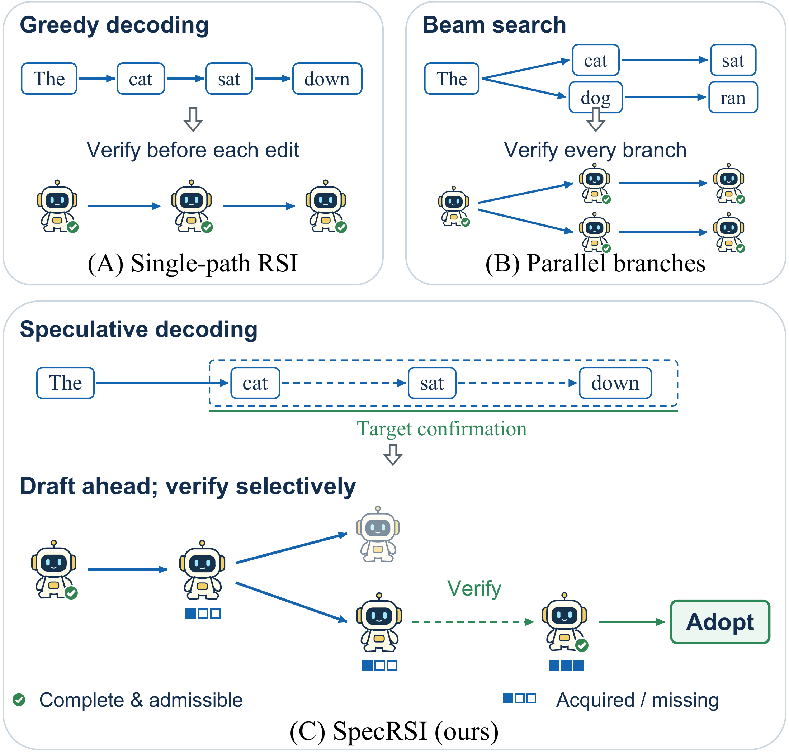
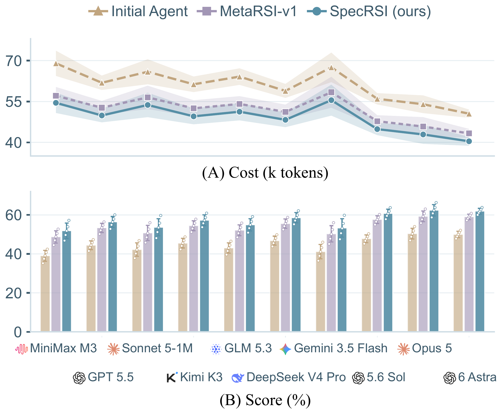
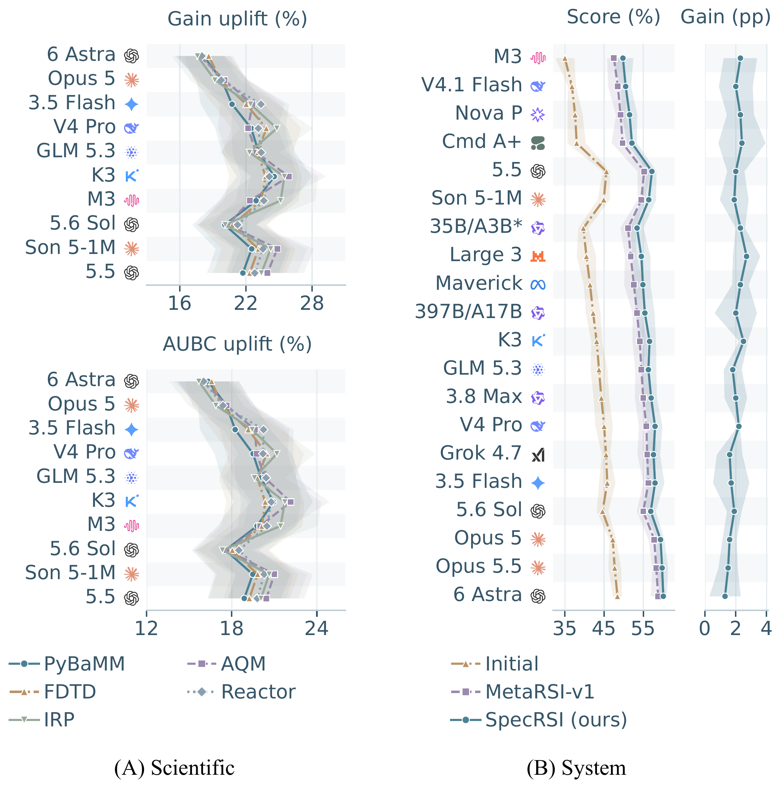
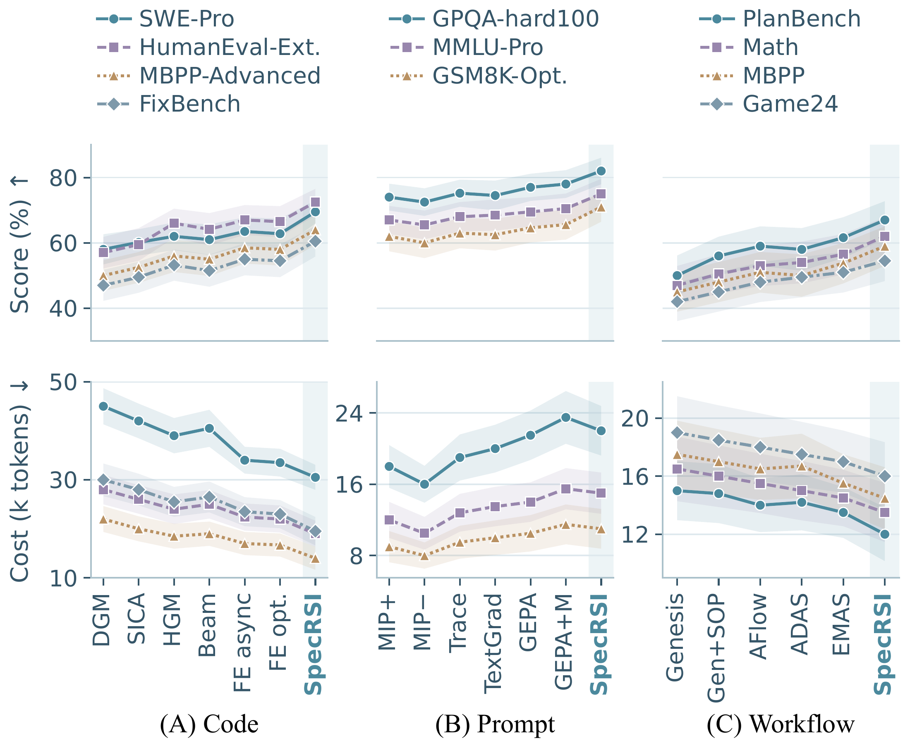
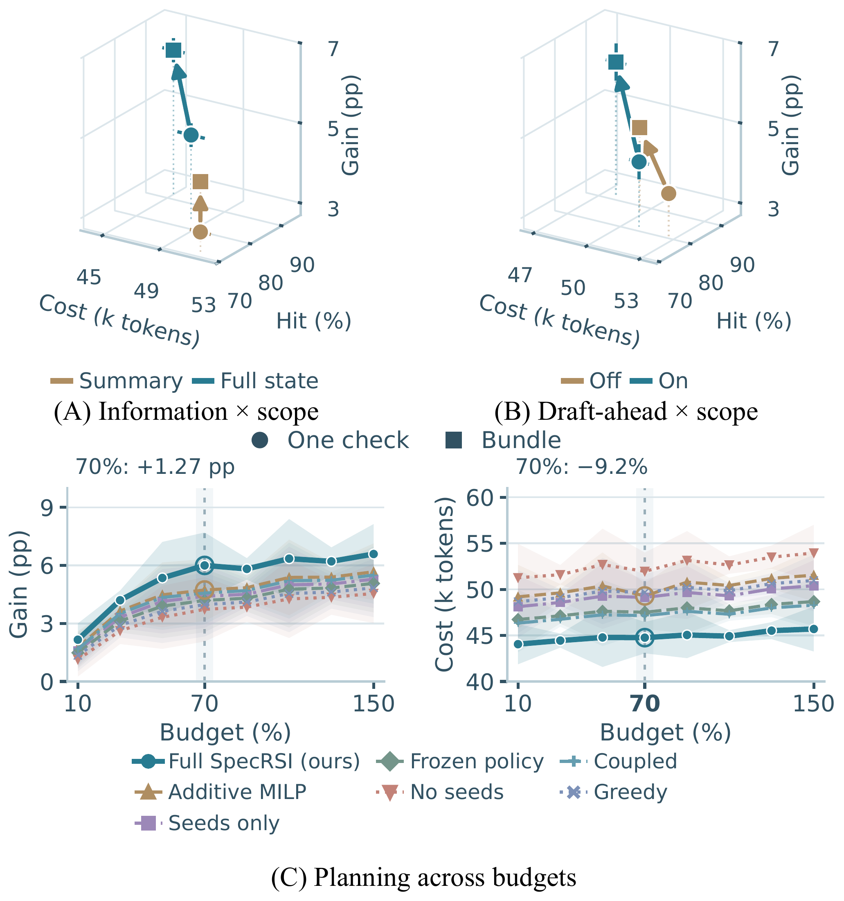
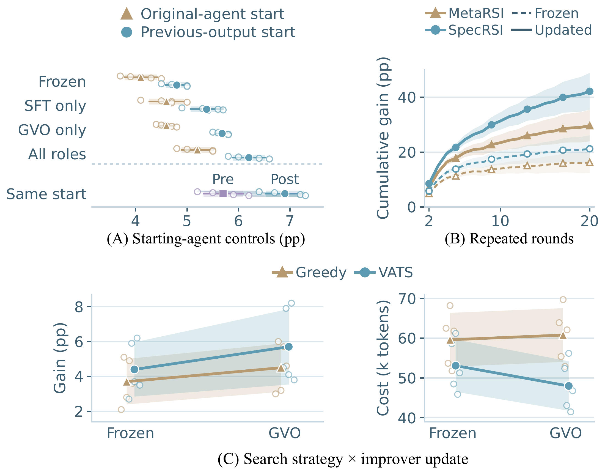
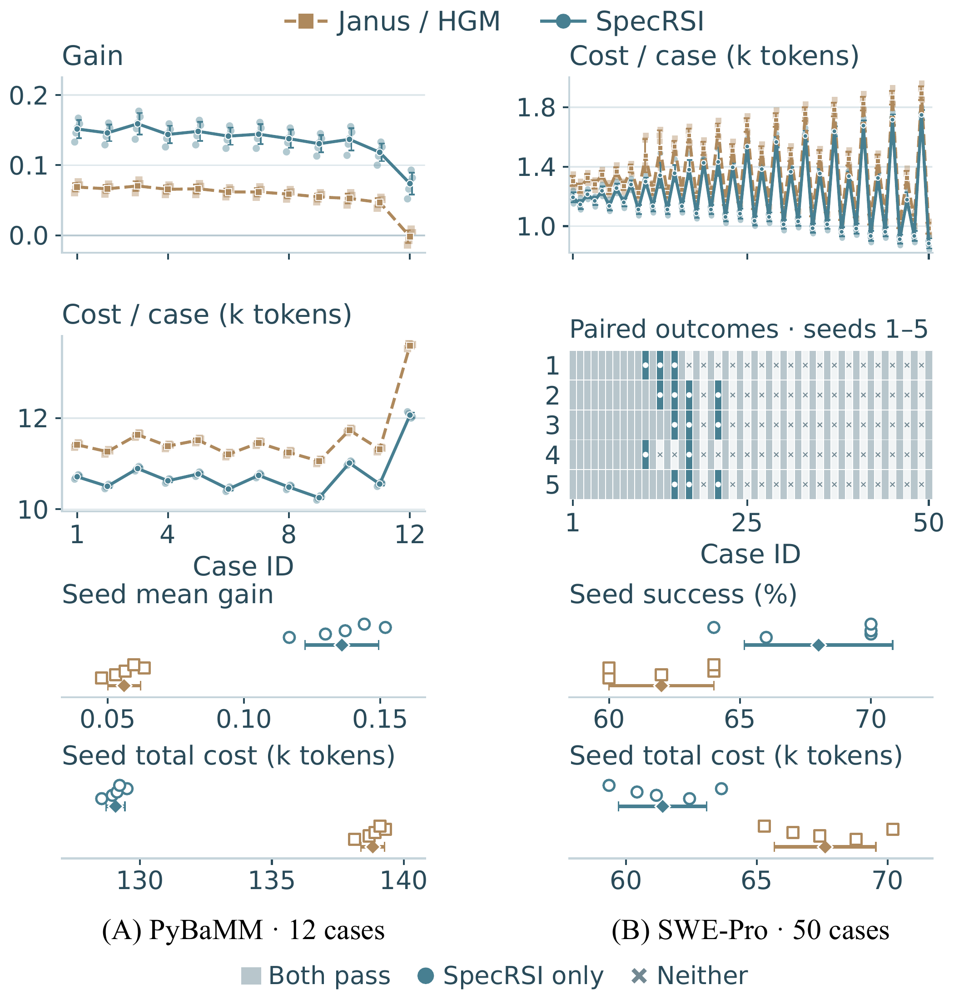
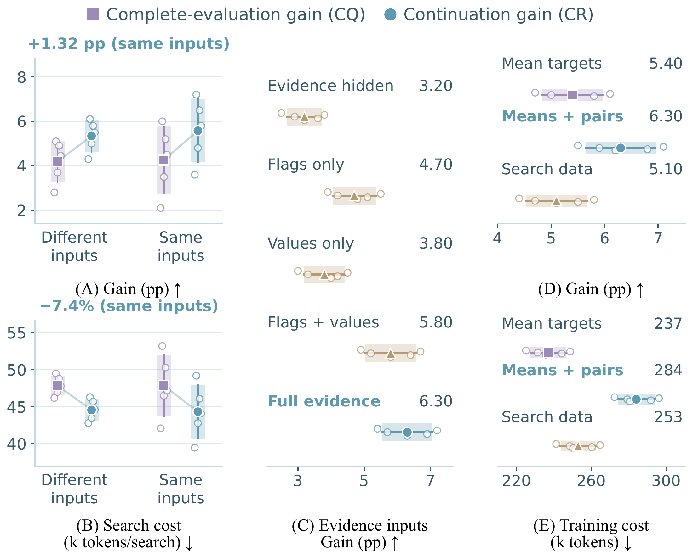

# SpecRSI: experimental materials for the paper

Figure and table numbers below follow the manuscript. The tables use the manuscript's displayed precision. SD is calculated across five seed means using the n−1 denominator.

The [Reactor implementation note](reactor_model.md) provides the 12 CSTR instances, dual-valve equations, runnable profile, and numerical safety checks.

## Contents

| Material | Contents |
| --- | --- |
| Figures 1–3 | Motivation, ten-backbone performance, and method architecture |
| Figures 4–5 | Cross-backbone and code/prompt/workflow performance |
| Figures 6–7 | VATS and GVO experiments |
| Figures S1–S2 | Instance-level results and scoring/evidence/supervision controls |
| Tables 1–2 | Main performance and resource trade-offs |
| Tables S1–S3 | Settings, paired comparisons, and evaluation protocols |
| Tables S4–S5 | PyBaMM and full D/H/M csvstat cases |

## Figure 1. From token decoding to agent self-improvement

Gray arrows mark structural analogies, while green dashed arrows indicate verification of the same agent version. SpecRSI drafts ahead, verifies selectively, and adopts only fully evaluated, admissible versions.

## Figure 2. Performance across ten backbones

Five-seed means with bands and whiskers showing ± SD. (A) Cost in k tokens; (B) score (%). Lines connect model categories, and logos denote model families.

## Figure 3. Two-level Speculative RSI Loop

Within each search, VATS allocates drafts and checks under a frozen improver before Accept returns the best complete admissible version; across searches, GVO updates the improver under a fixed contract Γ.

## Figure 4. Performance across backbones

Lines connect five-seed means; bands show ± SD. (A) Terminal-gain and AUBC uplift over Janus. (B) System scores and seed-paired gains, SpecRSI minus MetaRSI-v1. All 50 scientific pairs improve, and gains across twenty system backbones range from 1.30 to 2.70 pp.

## Figure 5. Code, prompt, and workflow performance

Columns show (A) Code, (B) Prompt, and (C) Workflow; rows show task score (%) and mean full-task inference cost (k tokens), with separate cost ranges. Points and bands show five-seed means ± SD. Scores improve by 3.5–6.0 pp over the best-scoring baseline on each task, with 3.2%–17.6% lower inference cost.

## Figure 6. Verification scope and planning ablations

(A) Information-scope controls with draft-ahead off. (B) Draft-ahead-scope controls with full-state inputs. Both report gain, cost, and pooled hit rate for 5 × 25 searches per condition. (C) Held-out gain and total cost across eight execution-only budget caps; 100% = 65 k tokens. Total cost also includes planning and other overhead, and negative held-out gains are retained. Bars and bands show ± SD across five seed means. Cohorts and accounting are specified in Table S3.

## Figure 7. Learning the improver

Lines and markers show five-seed means with ± SD shading; open circles in A and C show individual seeds. (A) Original-agent and previous-output starts plus an identical-start pre/post-GVO test. (B) Cumulative gain across rounds 2–20, comparing frozen improvers with improvers updated each round. (C) VATS × GVO control; total cost sums training and eight evaluation searches per seed. Protocols are in Table S3.

## Figure S1. Instance-level outcomes and cost

Five seeds cover 12 PyBaMM cases and 50 SWE-Pro cases per method (120 and 500 records). Small points denote seed runs; upper lines/bars show per-case means ± SD; lower panels summarize seed mean gain/success and seed-total cost. SWE-Pro has 155 both-pass, 15 SpecRSI-only, 0 HGM-only, and 80 neither-pass pairs. Costs are in k tokens; case IDs are categorical.

## Figure S2. Scoring, evidence, and supervision controls

Five-seed means with ± SD shading and individual seed circles. (A,B) Complete-evaluation gain (CQ) versus continuation gain (CR): matched inputs give +1.32 pp gain at 7.4% lower search-inference cost. (C) Evidence-input ablations preserve full Solver constraints and real verification. (D,E) Held-out supervision gain and training cost in k tokens. Cohorts and protocols are in Table S3.

## Manuscript tables

## Table 1. Scientific and system performance

Five-seed mean ± SD. Bold marks the best comparable mean. Scientific comparisons follow the [Janus protocol](https://arxiv.org/abs/2608.08189). System comparisons follow the [MetaRSI protocol](https://arxiv.org/abs/2609.06396v2) under matched editing permissions. D, H, and M denote data, harness, and model updates.

### A. Scientific terminal gain

Higher is better. Scores and terminal gains are in the dimensionless native task units.

| Method | PyBaMM | AQM | FDTD | Reactor | IRP |
| --- | --- | --- | --- | --- | --- |
| Alg.-Only [21](https://arxiv.org/abs/2506.13131) | 0.12 ± 0.02 | 0.09 ± 0.03 | 0.14 ± 0.05 | 0.11 ± 0.05 | 0.10 ± 0.07 |
| Direct-LLM [10](https://doi.org/10.1016/j.swevo.2024.101741) | 0.21 ± 0.03 | 0.17 ± 0.01 | 0.23 ± 0.02 | 0.18 ± 0.06 | 0.18 ± 0.05 |
| Embed-GP [27](https://proceedings.neurips.cc/paper_files/paper/2012/hash/05311655a15b75fab86956663e1819cd-Abstract.html) | 0.29 ± 0.03 | 0.26 ± 0.01 | 0.36 ± 0.03 | 0.29 ± 0.03 | 0.28 ± 0.06 |
| Janus [18](https://arxiv.org/abs/2608.08189) | 0.35 ± 0.05 | 0.30 ± 0.03 | 0.40 ± 0.02 | 0.33 ± 0.02 | 0.27 ± 0.04 |
| SpecRSI | **0.58 ± 0.02** | **0.52 ± 0.03** | **0.64 ± 0.01** | **0.55 ± 0.01** | **0.53 ± 0.03** |

### A. Call-axis AUBC

Higher is better. AUBC integrates gain over complete evaluation calls.

| Method | PyBaMM | AQM | FDTD | Reactor | IRP |
| --- | --- | --- | --- | --- | --- |
| Alg.-Only [21](https://arxiv.org/abs/2506.13131) | 7.3 ± 0.1 | 5.1 ± 0.8 | 8.5 ± 0.6 | 6.7 ± 0.2 | 5.8 ± 0.6 |
| Direct-LLM [10](https://doi.org/10.1016/j.swevo.2024.101741) | 19.2 ± 0.8 | 14.3 ± 0.5 | 22.6 ± 0.3 | 16.2 ± 0.1 | 13.7 ± 0.3 |
| Embed-GP [27](https://proceedings.neurips.cc/paper_files/paper/2012/hash/05311655a15b75fab86956663e1819cd-Abstract.html) | 30.5 ± 0.4 | 24.8 ± 0.1 | 36.2 ± 0.9 | 27.4 ± 0.2 | 23.1 ± 0.1 |
| Janus [18](https://arxiv.org/abs/2608.08189) | 42.8 ± 0.3 | 34.7 ± 0.9 | 51.4 ± 0.7 | 37.0 ± 0.2 | 22.6 ± 0.1 |
| SpecRSI | **57.7 ± 0.4** | **46.8 ± 0.1** | **67.9 ± 0.2** | **50.3 ± 0.4** | **43.3 ± 0.1** |

[Scientific CSV](tables/table1_scientific.csv)

### B. System scores (%)

Higher is better. Complete admissible versions are compared within each permission group.

**D/H/M permissions**

| Method | Terminal-Bench 2.1 | SWE-Pro | GPQA-hard100 | AIME |
| --- | --- | --- | --- | --- |
| Initial [29](https://arxiv.org/abs/2609.06396v2) | 23.6 ± 0.7 | 10.2 ± 0.3 | 71.2 ± 1.0 | 54.9 ± 0.5 |
| Data-RSI [29](https://arxiv.org/abs/2609.06396v2) | 27.4 ± 0.3 | 12.4 ± 0.8 | 73.8 ± 0.3 | 57.6 ± 0.1 |
| Harness-RSI [29](https://arxiv.org/abs/2609.06396v2) | 29.4 ± 0.6 | 14.8 ± 0.3 | 78.2 ± 0.7 | 63.1 ± 0.8 |
| Model-RSI [29](https://arxiv.org/abs/2609.06396v2) | 27.0 ± 0.3 | 13.9 ± 0.1 | 75.4 ± 0.6 | 59.7 ± 0.2 |
| Fixed D→M→H [29](https://arxiv.org/abs/2609.06396v2) | 30.3 ± 0.6 | 15.3 ± 0.3 | 79.5 ± 0.2 | 64.2 ± 0.6 |
| Static router [29](https://arxiv.org/abs/2609.06396v2) | 30.8 ± 0.2 | 14.9 ± 0.3 | 79.7 ± 0.9 | 64.0 ± 0.2 |
| MetaRSI-v1 [29](https://arxiv.org/abs/2609.06396v2) | 32.1 ± 0.3 | 19.5 ± 0.8 | 83.8 ± 0.2 | 68.5 ± 0.1 |
| SpecRSI | **35.6 ± 0.6** | **23.7 ± 0.1** | **87.3 ± 0.3** | **72.9 ± 0.3** |

**D+H permissions**

| Method | Terminal-Bench 2.1 | SWE-Pro | GPQA-hard100 | AIME |
| --- | --- | --- | --- | --- |
| MetaRSI-H [29](https://arxiv.org/abs/2609.06396v2) | 28.6 ± 0.5 | 14.2 ± 0.2 | 77.5 ± 0.5 | 61.7 ± 0.2 |
| SpecRSI-H | **32.1 ± 0.1** | **17.3 ± 0.5** | **80.9 ± 0.5** | **65.6 ± 0.1** |

[System CSV](tables/table1_system.csv)

## Table 2. Resource trade-offs

All entries are five-seed mean ± SD. Lifecycle costs are full-run totals per seed. Parallel execution compares wall-clock latency and accumulated active worker time.

### A. Candidate-plan limit

| Cap | Gain (pp) | Planning cost (k tokens) |
| --- | --- | --- |
| 8 | 5.2 ± 0.35 | 1.8 ± 0.12 |
| 16 | 5.8 ± 0.22 | 2.7 ± 0.15 |
| 32 | 6.3 ± 0.27 | 3.9 ± 0.21 |
| 64 | 6.5 ± 0.16 | 5.6 ± 0.23 |

[Candidate-plan CSV](tables/table2a_candidate_plans.csv)

### B. Lifecycle cost (k tokens)

| Category | MetaRSI-v1 | SpecRSI |
| --- | --- | --- |
| Acquisition | 14.5 ± 0.41 | 14.2 ± 0.35 |
| Training | 38.6 ± 0.96 | 34.8 ± 0.87 |
| Search | 37.2 ± 0.96 | 36.2 ± 0.86 |
| Reuse checks | 5.1 ± 0.26 | 4.8 ± 0.26 |
| Copies | 6.3 ± 0.26 | 6.1 ± 0.25 |
| Failed work | 6.8 ± 0.40 | 6.3 ± 0.32 |
| Planning | 4.2 ± 0.20 | 3.9 ± 0.20 |
| Total | 112.7 ± 3.44 | **106.3 ± 3.09** |

[Lifecycle CSV](tables/table2b_lifecycle.csv)

### C. Parallel execution

| Workers | Gain (pp) | Time (s) | Total worker time (worker-s) |
| --- | --- | --- | --- |
| 1 | 6.30 ± 0.20 | 1287 ± 21.79 | 1287.00 ± 21.79 |
| 2 | 6.40 ± 0.18 | 672 ± 10.91 | 1340.00 ± 24.51 |
| 3 | 6.40 ± 0.26 | 458 ± 9.80 | 1372.00 ± 28.25 |
| 4 | 6.40 ± 0.20 | 354 ± 6.40 | 1412.00 ± 26.08 |
| 5 | 6.40 ± 0.14 | 291 ± 5.43 | 1451.00 ± 28.08 |
| 6 | 6.50 ± 0.21 | 248 ± 5.43 | 1484.00 ± 33.52 |
| 7 | 6.50 ± 0.19 | 216 ± 4.47 | 1508.00 ± 31.76 |
| 8 | 6.50 ± 0.23 | 192 ± 4.47 | 1531.40 ± 34.51 |
| 9 | 6.50 ± 0.19 | 174 ± 4.47 | 1560.90 ± 39.00 |
| 10 | 6.50 ± 0.20 | 160 ± 4.47 | 1594.84 ± 44.63 |
| 12 | 6.60 ± 0.21 | 139 ± 4.47 | 1663.50 ± 54.46 |
| 14 | 6.60 ± 0.24 | 125 ± 4.47 | 1743.24 ± 63.23 |
| 16 | 6.60 ± 0.18 | 114 ± 4.85 | 1818.30 ± 75.62 |
| 18 | 6.64 ± 0.23 | 106 ± 4.47 | 1904.56 ± 80.43 |
| 20 | 6.70 ± 0.23 | 100 ± 4.47 | 1996.80 ± 89.01 |

8 workers give 6.7× speedup at 19.0% more worker time; 20 workers give 12.9× speedup at 55.2% more worker time, relative to one worker.

[Worker summary CSV](tables/table2c_workers.csv) · [All 75 worker seed records](tables/table2c_worker_seeds.csv)

## Table S1. Implementation and evaluation settings

| Setting | Value |
| --- | --- |
| Architecture | Frozen BF16 text representations; separate Scorer/Policy branches with typed relations and four-head set attention. Inputs: observed outcomes, missing checks, remaining resources, and proposed work. |
| Warm-up | Component minibatch 1. Drafter/Policy/Scorer targets are executed legal edits/legal choices/realized returns. Unexecuted alternatives receive no targets. |
| VATS solver | SciPy `milp` / HiGHS. |
| VATS target limits | Training/default targets, pair unions, and singleton closures: 2/2/2 versus 4/4/4. |
| VATS query and plan limits | Training/default (q_max, K_Ω, s_max) = (4, 8, 4) versus (96, 32, 4): uncached Scorer queries, retained plans, and accepted extensions per seed. |
| GVO objective | λ = μ = 0: verified gain under hard caps, with cost features and feasibility active. Nonzero penalties use a separate profile. |
| GVO updates | At most one joint SGD step per collection. Scorer/actor learning rates: 5×10⁻⁴ / 10⁻³. (ε_c, β_pair, β_KL) = (0.2, 1, 0.02). Zero momentum and weight decay; no gradient-norm clipping. |
| Execution | Training uses 2,048-token sequences and one H20 per scientific domain. Inference uses a 32,768-token limit and a separate H20. Other backbones use frozen transfer through provider APIs. |
| Scientific evaluation | 12 held-out instances per task. |
| PyBaMM | Version 23.5. J = 1 − MSE/MSE_ref, dimensionless; MSE = N⁻¹ Σᵢ(V_pred,i − V_true,i)², in V². The reference is fixed unoptimized industry defaults, distinct from the search root. Acceptance requires physical bounds and convergence. |
| AQM | 12 parameters and 12 scenarios. U = 0.4g_raw/g_max − 0.3d₉₅/d₉₅,base − 0.2ℓ − 0.1(1−f). Throughput is normalized by link capacity; 95th-percentile delay by initial-controller delay. ℓ is loss fraction and f is Jain fairness. Requires legal parameters, stable queues, and no sustained packet loss. |
| FDTD / Reactor / IRP | Scores are normalized to [0,1]. FDTD requires convergence and crosstalk ≤ −20 dB. Reactor requires convergence and safe temperature/pressure. IRP requires feasible constraints and service level ≥95%. |
| Public AQM | ns-3.44, seven RED/ECN parameters; three TCP NewReno patterns × two seeds per case, 8 s per run; 20-Mb/s dumbbell and four flows. Mean utility g − d₉₅ − 2ℓ − 0.5(1−f), where g is normalized goodput and d₉₅ is 95th-percentile end-to-end delay in seconds. Legal parameters and all six outputs are required; measured simulator time is charged. |
| System tasks | Terminal-Bench 2.1, SWE-Pro v1.0, GPQA-hard100, and AIME 2025 I/II (30 problems). |
| Lifecycle accounting | Table 2 uses all-round totals per seed, including fine-tuning input/output tokens and serialized snapshots/trajectories. |
| Resource experiment defaults | PyBaMM, 65-k-token search budget, 32 candidate plans, and one H20. Worker threads share global state/caches; worker time sums active execution. |
| Training cost in Figure S2E | Forward input/output and forced-continuation tokens are counted. Search is charged separately; backward computation is measured in GPU time. |

[Settings CSV](tables/table_s1_implementation.csv)

## Table S2. Paired comparisons

Differences are SpecRSI minus baseline or follow the named direction. All seven are positive in all five seed pairs. † denotes held-out evaluation; the final two rows report in-search gain.

**RQ1**

| Comparison | Difference | 95% CI | Unit |
| --- | --- | --- | --- |
| PyBaMM gain: vs. Janus† | +0.07992 | [0.07057, 0.08926] | native task units |
| SWE-Pro success: vs. HGM† | +6.00 | [4.244, 7.756] | pp |
| Reference-system mean: vs. MetaRSI-v1† | +3.90 | [3.834, 3.966] | pp |
| PyBaMM AUBC: vs. Janus† | +14.9 | [14.776, 15.024] | native gain × calls |

**RQ2/RQ3**

| Comparison | Difference | 95% CI | Unit |
| --- | --- | --- | --- |
| Full − Additive MILP (70%)† | +1.27 | [1.118, 1.422] | pp |
| Full state: bundle − single | +1.50 | [1.475, 1.525] | pp |
| Same start: updated − original | +1.20 | [1.112, 1.288] | pp |

[Paired-comparison CSV](tables/table_s2_paired.csv)

## Table S3. Additional evaluation protocols

Costs are in k tokens; supervision summaries report five-seed mean ± SD.

| Result | Protocol |
| --- | --- |
| Instance comparisons | Matched starts, token caps, and cases; five paired within-seed means; pointwise 95% intervals d̄ ± t₀.₉₇₅,₄ s_d/√5. System scores weight four tasks equally. Held-out gain follows Equation (15), retaining negative values. |
| Figure 2 | First complete admissible output satisfying [J(c) − J(r)] / abs(J(r)) ≥ 0.05; if J(r) = 0, absolute gain ≥0.05. Otherwise, use the best admissible output at termination. Thresholds are task-specific; tasks have equal weights. Token accounting follows Section 4.1. |
| Cohorts | Figure 6 uses separate cohorts for A, B, and C. Figure S2 uses separate cohorts for A–B, C, and D–E. |
| Figure S2A,B | PyBaMM: original/matched conditions use 25/8 searches per seed. Original CQ omits resource inputs and uses its own stopping rule; CR uses full inputs. Matched conditions have identical network/state inputs, stopping/ACCEPT rules, training data, and a 65-k-token budget; only targets differ. |
| Figure S2C | Eight PyBaMM searches per seed, 65 k tokens. The same trained Scorer/Policy is masked at test time; complete Solver inputs and real Γ verification remain intact. Flags are available/missing indicators; observations include values, admissibility, and validity; relations include dependency/shared-setup/source-reuse links. Hidden/flags-only/values-only/restored/full correspond to (000)/(100)/(010)/(110)/(111). Remaining budget and attempts are always visible. |
| Figures 6A,B and 7C | Mean final ACCEPT gain. Failures and root returns count as zero in-search gain. |
| Figure 6C cost decomposition | Accounting follows Appendix D. At 10% budget, mean total cost is 44.05 = 6.32 drafting/verification + 2.08 initialization/contract loading + 35.65 planning/Scorer queries/state checks, in k tokens. |
| Figure S2D,E | Identical snapshots/trajectories train mean returns with or without pairwise return-difference targets. Ordinary-search data use mean targets and acquisition cost matched within 2%. Gain is measured on independent held-out complete searches. |
| Figure S2D,E summary | Mean-only / +pair / ordinary-search gain: 5.40 ± 0.57 / 6.30 ± 0.65 / 5.10 ± 0.57 pp. Training cost: 237.00 ± 9.53 / 284.00 ± 9.71 / 253.00 ± 9.45 k tokens. |
| Figure 7A | Shared Θ₀: Frozen/GVO-only/All roles update none/Drafter–Policy/all modules. SFT-only uses random adapters/heads, one epoch on full search trajectories, actor cross-entropy plus Scorer regression; warm-up uses fewer demonstrations. |
| Figure 7B | Each curve has 20 rounds × three searches. Updated curves apply one GVO step or native MetaRSI update per round; frozen curves retain initial improvers. All curves carry the previous best complete admissible output, or unchanged root; reset evidence/budgets; and sum within-seed gains over rounds 2–20. |
| Figure 7C | PyBaMM with matched starts, permissions, contracts, and budgets. Greedy scores current candidate gain without continuation scoring, draft-ahead, or bundles. The final frozen improver performs eight independent searches per seed after training. Total cost includes training collections and the eight evaluation searches. |

[Protocol CSV](tables/table_s3_protocols.csv)

### Numeric summary within Table S3 / Figure S2D,E

| Condition | Held-out gain (pp) | Training cost (k tokens) |
| --- | --- | --- |
| Same arms / means | 5.40 ± 0.57 | 237.00 ± 9.53 |
| Same arms / means + pair | 6.30 ± 0.65 | 284.00 ± 9.71 |
| Equal-acquisition-cost search | 5.10 ± 0.57 | 253.00 ± 9.45 |

[Supervision-summary CSV](tables/figure_s2de_supervision.csv)

## Table S4. PyBaMM calibration case

The median gain-difference case among the 12 instances in Figure S1A. Scores and gains are dimensionless; costs are in k tokens. Execution traces describe representative individual runs; score and cost summaries use five seeds.

| Item | Shared setup |
| --- | --- |
| Setup | PyBaMM v23.5; shared root and 140 complete-evaluation-call budget. Calibrates seven NMC–graphite single-particle-model parameters against a 1C discharge curve at 25°C, including diffusivity, SEI resistance, and exchange-current values/SOC dependence. |
| Root | Constant diffusivity/SEI resistance; maximal mid-SOC voltage error; underestimated low-SOC resistance; 100-fold exchange-current prefactor error. J(r) = 0.280 and RMSE = 28.7 mV. |
| Score and acceptance | Fixed-reference RMSE ≈33.8 mV; J(c) = 1 − MSE(c)/MSE_ref. Physical bounds and convergence determine admissibility. The 15-mV optimization target (J ≈0.80) is not an admissibility threshold. |

| Item | Janus | SpecRSI |
| --- | --- | --- |
| Typical trace | Calibrates constant diffusivity, then SEI resistance, simulating each step. Proxy screening rejects the joint edit after five proxy evaluations and two full 800-s simulations. | Drafts piecewise SOC-dependent diffusivity, exponential SOC-dependent SEI resistance, and exchange-current/concentration corrections. One bound check and one final simulation verify all three edits without intermediate full simulations. |
| Five-seed scores | 0.339, 0.344, 0.347, 0.353, 0.349 | 0.409, 0.421, 0.427, 0.440, 0.433 |
| Mean score | 0.3464 | 0.4260 |
| RMSE equivalent (mV) | 27.3 | 25.6 |
| Mean gain | 0.0664 | 0.1460 |
| Mean search cost (k tokens) | 11.264 | 10.504 |
| Token shares | Simulation interaction / proxy / generation: 62% / 21% / 17%. | Simulation interaction / bounds / generation / planning: 39% / 8% / 36% / 17%. |

**Analysis.** By composing three sequential drafts before full simulation, SpecRSI achieves 119.9% higher mean gain at 6.7% lower token cost.

[Setup CSV](tables/table_s4_pybamm_setup.csv) · [Case CSV](tables/table_s4_pybamm_case.csv) · [Summary CSV](tables/table_s4_pybamm_summary.csv) · [Five-seed score CSV](tables/table_s4_pybamm_scores.csv)

## Table S5. Full D/H/M csvstat case

Corresponds to the system setting in Table 1B. Search costs are five-seed means in k tokens. Execution traces describe representative individual runs.

| Item | Shared setup |
| --- | --- |
| Setup | Shared root and 3.5-k-token budget with data, harness, and task-model editing. Repairs accumulation and adds `--weight` for weighted mean/variance. Requires 28 target tests plus clean syntax/lint. |
| Root | 21/28 target tests pass (75%). No weighting support; 10⁻⁶-order error on mixed large/small values. |
| Search-cost accounting | Five-seed means in k tokens. Counts input/output and tool-return tokens, excluding simulator/test runtime and separately tracked LoRA training. |

| Item | MetaRSI-v1 | SpecRSI |
| --- | --- | --- |
| Typical trace | Replaces summation with Kahan compensation and attempts weighted means. Two boundary-test failures halt that branch after three full pytest runs. | Drafts compensated summation, weight parsing, weighted mean/variance, and boundary handling alongside a task-model LoRA update. Syntax, precision, weighting-subset, and lightweight post-update checks precede one full pytest/pyflakes run. |
| Final target tests | 26/28 (92.9%); weighting incomplete. | 28/28 (100%); both features complete. |
| Mean search cost (k tokens) | 3.185 | 2.974 |
| Token shares | Full-test interaction / generation / other search inference: 69% / 22% / 9%. | Full-test interaction / staged checks / generation / other search inference: 31% / 14% / 38% / 17%. |

**Analysis.** SpecRSI completes both features with fewer full test runs and 6.6% lower search-token cost, jointly verifying code and adapter updates before adoption.

[Setup CSV](tables/table_s5_csvstat_setup.csv) · [Case CSV](tables/table_s5_csvstat_case.csv) · [Summary CSV](tables/table_s5_csvstat_summary.csv)

## Online-only materials

The [online supplement](online_supplement.md) and [PDF](online_supplement.pdf) contain the Drafter prompt template and the additional [D+H csvcut case with frozen model weights](online_supplement.md#table-o2-dh-csvcut-case).

## Version and scope

[Implementation and run instructions](../REPRODUCIBILITY.md) describe the model, data preparation, and configuration profiles.
